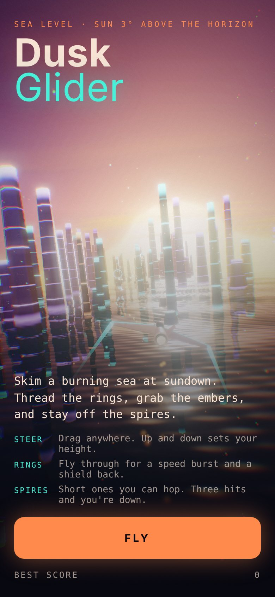
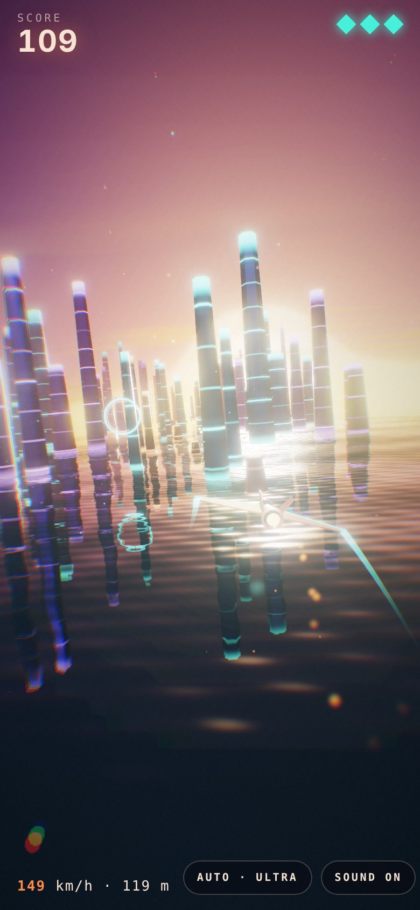
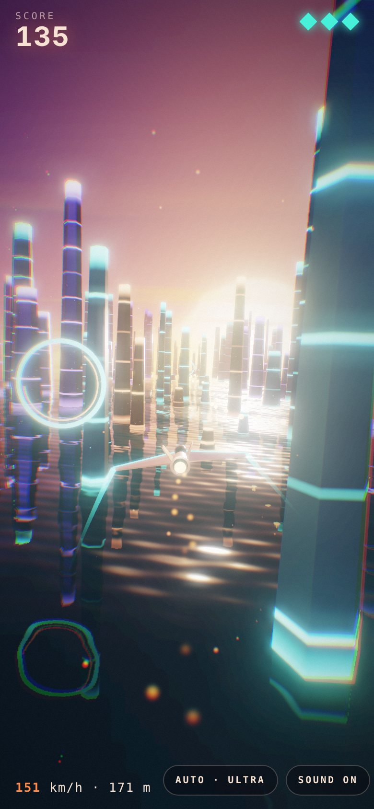
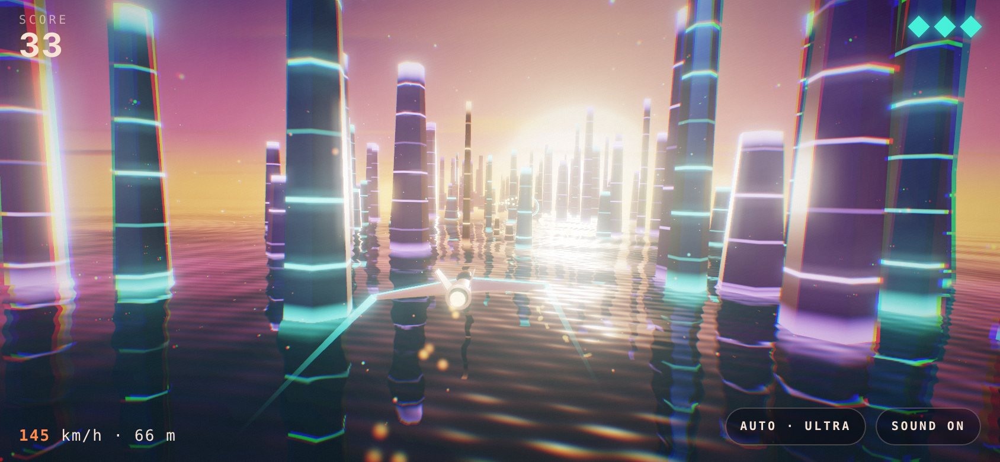
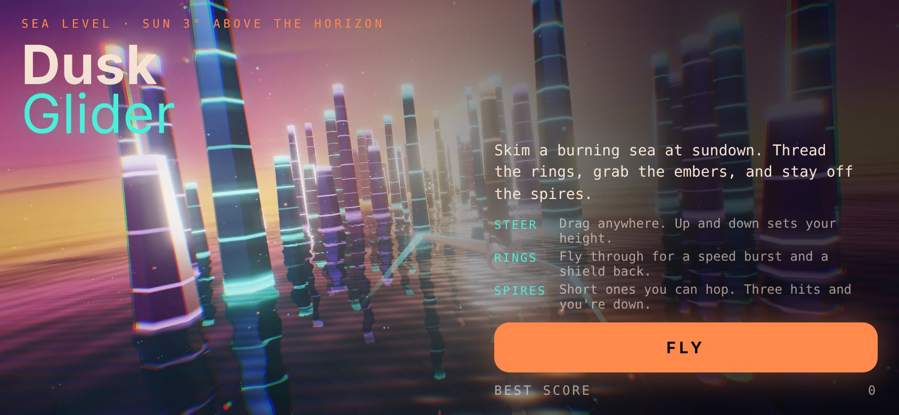

# Dusk Glider

A 3D flying game made for the iPhone 14. Skim a glowing sea at sundown, fly through rings, grab embers and dodge crystal spires.

**Play:** https://hardwaremack-prog.github.io/dusk-glider/

  
  
  

  

  

## Put it on your iPhone home screen
1. Open the Play link in **Safari**.
2. Tap **Share**, then **Add to Home Screen**.
3. Launch it from the new icon. It opens full screen like an app.

## How to play
- **Steer:** drag anywhere. Up and down sets your height.
- **Rings:** fly through for a speed burst and a shield back.
- **Spires:** short ones you can hop. Three hits and you're down.
- **Close calls** past a spire earn bonus points.

## Graphics
Full 3× Retina resolution, HDR bloom, live water reflections, animated waves, particle exhaust, wingtip trails and a lens effect on boost. The quality button switches between Ultra, High, Balanced and Smooth. On Auto it steps down if the frame rate drops below about 50.

Everything is in one file (`index.html`) with the 3D engine built in, so it needs no internet once loaded.
